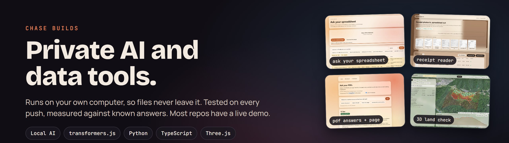

         

<b>I build tools that do the boring part of your job for you, and I prove they work.</b> 48 public projects, 43 with a live demo you can try in your browser. Every one is tested on each push, and most are scored against data where the right answer is known.

## Pick your industry

<table>
<tr>
<td width="25%" valign="top"><a href="#real-estate-and-appraisal"><b>🏠 Real estate and appraisal</b></a> agents, appraisers, assessors</td>
<td width="25%" valign="top"><a href="#small-business-and-local-services"><b>🛠️ Small business</b></a> shops, trades, restaurants</td>
<td width="25%" valign="top"><a href="#office-bookkeeping-and-admin"><b>📑 Office and bookkeeping</b></a> spreadsheets, PDFs, invoices</td>
<td width="25%" valign="top"><a href="#construction-and-land"><b>⛰️ Construction and land</b></a> developers, builders, surveyors</td>
</tr>
<tr>
<td width="25%" valign="top"><a href="#marketing-and-creative"><b>🎨 Marketing and creative</b></a> brands, agencies, landing pages</td>
<td width="25%" valign="top"><a href="#data-and-analytics"><b>📊 Data and analytics</b></a> reports, dashboards, data quality</td>
<td width="25%" valign="top"><a href="#security-and-it"><b>🔒 Security and IT</b></a> website checkups, private tools</td>
<td width="25%" valign="top"><a href="#ai-and-automation"><b>🤖 AI and automation</b></a> local AI, scripts, APIs</td>
</tr>
</table>

<b>Everything on this page</b> (full table of contents)

| Start here | Browse the work | Proof | Work with me |
|---|---|---|---|
| [Pick your industry](#pick-your-industry) | [Featured demos](#featured) | [Benchmarks](#benchmarks) | [Services](#services) |
| [How I work](#how-i-work) | [By industry](#real-estate-and-appraisal) | [How I test](#how-i-test) | [Book a free call](https://calendly.com/chasebuilds-ky/30min) |
| [FAQ](#faq) | [By skill](#by-skill) | [Tech stack](#tech-stack) | [Website](https://chasebuilds.github.io) |
| [Now building](#now-building) | [Live demos](#live-demos) | [Releases](https://github.com/chasebuilds?tab=repositories) | [Reuse and license](#reuse-and-license) |
| | [All 48 projects](#all-projects) | | [Privacy](#privacy) |

---

## Real estate and appraisal

For agents, appraisers and assessors who live in comps, spreadsheets and MLS exports.

| Project | What it does for you | Demo |
|---|---|---|
| [comparable-sales-grid](https://github.com/chasebuilds/comparable-sales-grid) | Picks comps, adjusts each line with rates measured from your own sales, and gives a value range. Within 5% on 93.0% of test homes. | [Open](https://chasebuilds.github.io/comparable-sales-grid/) |
| [seller-net-sheet-cma](https://github.com/chasebuilds/seller-net-sheet-cma) | Seller net sheet, buyer cash to close and a CMA presentation in one page. 20,000 of 20,000 prorations correct to the cent. | [Open](https://chasebuilds.github.io/seller-net-sheet-cma/) |
| [listing-kit](https://github.com/chasebuilds/listing-kit) | One file becomes a listing website with gallery, map and flyer, plus a fair-housing wording checker. | [Open](https://chasebuilds.github.io/listing-kit/) |
| [showing-route-planner](https://github.com/chasebuilds/showing-route-planner) | Orders a day of showings around every listing window with the least driving. Works offline on a phone. | [Open](https://chasebuilds.github.io/showing-route-planner/) |
| [listing-data-normalizer](https://github.com/chasebuilds/listing-data-normalizer) | Turns messy MLS and county exports into one clean table, with duplicates merged and price history kept. | [Open](https://chasebuilds.github.io/listing-data-normalizer/) |

More: [home-value-model](https://github.com/chasebuilds/home-value-model) · [income-approach-valuation](https://github.com/chasebuilds/income-approach-valuation) · [cost-approach-calculator](https://github.com/chasebuilds/cost-approach-calculator) · [assessment-ratio-study](https://github.com/chasebuilds/assessment-ratio-study) · [housing-market-trends](https://github.com/chasebuilds/housing-market-trends) · [valuation-report-builder](https://github.com/chasebuilds/valuation-report-builder)

Analysis and education tools, not appraisals. [Back to top](#top)

## Small business and local services

For shops, trades, salons and restaurants that need to be found online and stop doing things by hand.

| Project | What it does for you | Demo |
|---|---|---|
| [local-business-site](https://github.com/chasebuilds/local-business-site) | A fast one-page website with hours, services, map and a quote button, built from one short file. | [Open](https://chasebuilds.github.io/local-business-site/) |
| [field-service-pwa](https://github.com/chasebuilds/field-service-pwa) | Phone app for crews: job tickets, photos, parts, time, customer signature and invoice. Works with no signal. | [Open](https://chasebuilds.github.io/field-service-pwa/) |
| [appointment-booking-api](https://github.com/chasebuilds/appointment-booking-api) | Online booking that never double-books and gets time zones right. | [Open](https://chasebuilds.github.io/appointment-booking-api/) |
| [sheets-automations](https://github.com/chasebuilds/sheets-automations) | Google Sheets that send summaries, invoices, overdue reminders and low-stock alerts on their own. | [Open](https://chasebuilds.github.io/sheets-automations/) |
| [small-business-county-study](https://github.com/chasebuilds/small-business-county-study) | How small businesses are doing in 31 Eastern Kentucky counties, from free Census data. | [Open](https://chasebuilds.github.io/small-business-county-study/) |

[Back to top](#top)

## Office, bookkeeping and admin

For offices where the real work happens in Excel, PDFs and email attachments.

| Project | What it does for you | Demo |
|---|---|---|
| [pdf-to-excel](https://github.com/chasebuilds/pdf-to-excel) | Invoice PDFs into one Excel sheet, with a confidence score on every field. 3,600 of 3,600 fields correct. | [Open](https://chasebuilds.github.io/pdf-to-excel/) |
| [excel-cleaner-pro](https://github.com/chasebuilds/excel-cleaner-pro) | Cleans messy spreadsheets and logs every change, so nothing disappears quietly. | [Open](https://chasebuilds.github.io/excel-cleaner-pro/) |
| [transaction-categorizer](https://github.com/chasebuilds/transaction-categorizer) | Sorts bank and card transactions into categories and builds the monthly summary. | [Open](https://chasebuilds.github.io/transaction-categorizer/) |
| [data-merger](https://github.com/chasebuilds/data-merger) | Combines customer lists with different columns into one record per customer. 0 false merges on 28,512 rows. | [Open](https://chasebuilds.github.io/data-merger/) |
| [excel-formula-auditor](https://github.com/chasebuilds/excel-formula-auditor) | Finds broken formulas, hard-coded numbers and dead links before they cost you. | [Open](https://chasebuilds.github.io/excel-formula-auditor/) |

More: [pdf-table-extractor](https://github.com/chasebuilds/pdf-table-extractor) · [spreadsheet-diff](https://github.com/chasebuilds/spreadsheet-diff) · [address-normalizer](https://github.com/chasebuilds/address-normalizer) · [csv-combine-split](https://github.com/chasebuilds/csv-combine-split) · [table-export-extension](https://github.com/chasebuilds/table-export-extension)

[Back to top](#top)

## Construction and land

For developers, builders and anyone sizing up a piece of ground before paying an engineer.

| Project | What it does for you | Demo |
|---|---|---|
| [land-feasibility-3d](https://github.com/chasebuilds/land-feasibility-3d) | Real USGS terrain in 3D with slope, lot layout, cut and fill, and flood checks, plus a quick pro forma. | [Open](https://chasebuilds.github.io/land-feasibility-3d/) |
| [cost-approach-calculator](https://github.com/chasebuilds/cost-approach-calculator) | Replacement cost, depreciation and land value, with every step shown. | [Open](https://chasebuilds.github.io/cost-approach-calculator/) |
| [field-service-pwa](https://github.com/chasebuilds/field-service-pwa) | Job tickets, photos and sign-off from the job site, even offline. | [Open](https://chasebuilds.github.io/field-service-pwa/) |
| [pc-build-planner](https://github.com/chasebuilds/pc-build-planner) | A parts list for an office or CAD workstation where every part fits. | [Open](https://chasebuilds.github.io/pc-build-planner/) |

Screening tools, not engineering. [Back to top](#top)

## Marketing and creative

For brands and landing pages that should make people stop scrolling.

| Project | What it does for you | Demo |
|---|---|---|
| [window-hero](https://github.com/chasebuilds/window-hero) | Your homepage becomes a window: the 3D scene shifts as the visitor moves. Camera optional and on-device only. | [Open](https://chasebuilds.github.io/window-hero/) |
| [dither-pond](https://github.com/chasebuilds/dither-pond) | A stylized 3D scene with a day-to-night slider and a mix of animals, boat, bike, wind and water. | [Open](https://chasebuilds.github.io/dither-pond/) |
| [notebook-shelf](https://github.com/chasebuilds/notebook-shelf) | A shelf of notebooks that open in 3D. Great for portfolios, menus and catalogs. | [Open](https://chasebuilds.github.io/notebook-shelf/) |
| [liquid-logo-studio](https://github.com/chasebuilds/liquid-logo-studio) | Turns any logo into animated liquid chrome or gold, ready to export or embed. | [Open](https://chasebuilds.github.io/liquid-logo-studio/) |
| [r3f-showcase](https://github.com/chasebuilds/r3f-showcase) | 3D product configurator, scroll hero and gallery wall for a business site. | [Open](https://chasebuilds.github.io/r3f-showcase/) |

More: [cursor-fluid](https://github.com/chasebuilds/cursor-fluid) · [motion-design-gallery](https://github.com/chasebuilds/motion-design-gallery)

[Back to top](#top)

## Data and analytics

For teams that need numbers they can trust and reports that build themselves.

| Project | What it does for you | Demo |
|---|---|---|
| [automated-reporting-system](https://github.com/chasebuilds/automated-reporting-system) | Weekly exports in, finished Excel report and dashboard out. Stops itself when the data looks wrong. | [Open](https://chasebuilds.github.io/automated-reporting-system/) |
| [react-analytics-dashboard](https://github.com/chasebuilds/react-analytics-dashboard) | Sales and operations dashboard with filters, charts and CSV export. | [Open](https://chasebuilds.github.io/react-analytics-dashboard/) |
| [data-quality-checks](https://github.com/chasebuilds/data-quality-checks) | Catches bad data before it reaches a report. 1,784 of 1,800 planted faults caught, 0 false alarms. | [Open](https://chasebuilds.github.io/data-quality-checks/) |
| [housing-market-trends](https://github.com/chasebuilds/housing-market-trends) | Monthly market metrics and a time-adjustment rate with a confidence band. | [Open](https://chasebuilds.github.io/housing-market-trends/) |
| [business-research-tool](https://github.com/chasebuilds/business-research-tool) | Company research sheets where every fact has a source. | |

More: [excel-to-sql](https://github.com/chasebuilds/excel-to-sql) · [json-to-tables](https://github.com/chasebuilds/json-to-tables) · [product-matcher](https://github.com/chasebuilds/product-matcher) · [lead-list-qa](https://github.com/chasebuilds/lead-list-qa)

[Back to top](#top)

## Security and IT

For small businesses that want to know their website and files are safe, without a big IT bill.

| Project | What it does for you | Demo |
|---|---|---|
| [pii-redactor](https://github.com/chasebuilds/pii-redactor) | Hides names, emails, phone, SSN and card numbers in files before you share them, with a review sheet. Runs offline. | [Open](https://chasebuilds.github.io/pii-redactor/) |
| [site-security-check](https://github.com/chasebuilds/site-security-check) | A gentle, passive checkup of your own website, with a plain-English grade and fixes in order. | [Open](https://chasebuilds.github.io/site-security-check/) |
| [pdf-qa-local](https://github.com/chasebuilds/pdf-qa-local) | Ask questions about your PDFs with AI that runs on your own computer, so documents never leave the office. | |
| [table-export-extension](https://github.com/chasebuilds/table-export-extension) | Export any web table to Excel. No data leaves the browser. | [Open](https://chasebuilds.github.io/table-export-extension/) |
| [pc-build-planner](https://github.com/chasebuilds/pc-build-planner) | Plan office computers where every part is compatible. | [Open](https://chasebuilds.github.io/pc-build-planner/) |

Checkups only on sites you own, with your OK. [Back to top](#top)

## AI and automation

For anyone who wants the repetitive part of a job done by a script or a private AI.

| Project | What it does for you | Demo |
|---|---|---|
| [pdf-qa-local](https://github.com/chasebuilds/pdf-qa-local) | Private answers from a folder of PDFs, citing file and page. Right page on 29 of 30 test questions. | |
| [webgpu-agent-kit](https://github.com/chasebuilds/webgpu-agent-kit) | Helps AI coding agents write GPU code that actually runs. 10 of 10 examples render clean. | [Open](https://chasebuilds.github.io/webgpu-agent-kit/) |
| [web-data-extractor](https://github.com/chasebuilds/web-data-extractor) | Public web pages to a checked spreadsheet, only where the site allows it. | |
| [sheets-automations](https://github.com/chasebuilds/sheets-automations) | Spreadsheets that email, invoice and remind on their own. | [Open](https://chasebuilds.github.io/sheets-automations/) |
| [self-healing-agents](https://github.com/chasebuilds/self-healing-agents) | Agents that check whether their own output still reaches a person. | |

More: [pii-redactor](https://github.com/chasebuilds/pii-redactor) · [faceless-video-pipeline](https://github.com/chasebuilds/faceless-video-pipeline) · [appointment-booking-api](https://github.com/chasebuilds/appointment-booking-api)

[Back to top](#top)

---

### Featured

Live demos run in the browser. Click a picture to open one.

<!--SHOWCASE-->
<table>
<tr><td width="50%" valign="top"> <b><a href="https://github.com/chasebuilds/r3f-showcase">r3f-showcase</a></b> React Three Fiber scenes: product configurator, scroll-driven hero, gallery wall, GLSL lava planet. Lighthouse mobile 76 to 90 on the 3D pages</td><td width="50%" valign="top"> <b><a href="https://github.com/chasebuilds/webgpu-agent-kit">webgpu-agent-kit</a></b> 10 WebGPU examples, naga WGSL validation, a CLI and an MCP server so coding agents write GPU code that runs. 10 of 10 examples render with no validation errors</td></tr>
<tr><td width="50%" valign="top"> <b><a href="https://github.com/chasebuilds/liquid-logo-studio">liquid-logo-studio</a></b> Logo to liquid metal: distance-field bevel and reflection shader in WebGL2, PNG and WebM export, one-tag embed. Embed script 8,000 bytes gzipped</td><td width="50%" valign="top"> <b><a href="https://github.com/chasebuilds/cursor-fluid">cursor-fluid</a></b> Stable-fluids solver in WebGL2: advection, Jacobi pressure solve, vorticity confinement, adaptive quality. 6,984 bytes gzipped, zero dependencies</td></tr>
<tr><td width="50%" valign="top"> <b><a href="https://github.com/chasebuilds/dither-pond">dither-pond</a></b> three.js scene through an ordered-dither pass: Bayer 4x4 and 8x8, void-and-cluster blue noise, time-of-day palettes. 38 fps with software rendering, no GPU</td><td width="50%" valign="top"> <b><a href="https://github.com/chasebuilds/window-hero">window-hero</a></b> Off-axis projection driven by on-device face tracking (MediaPipe FaceLandmarker) for a window-into-a-room landing hero. 1,070 fps uncapped; tracker loads only after opt-in</td></tr>
<tr><td width="50%" valign="top"> <b><a href="https://github.com/chasebuilds/land-feasibility-3d">land-feasibility-3d</a></b> USGS LiDAR terrain in 3D with slope classes, lot layout, cut and fill, flood and stream checks. Pad cut volumes within 3.9% on synthetic terrain</td><td width="50%" valign="top"> <b><a href="https://github.com/chasebuilds/home-value-model">home-value-model</a></b> Automated valuation model: hedonic ridge and gradient boosting, time-split test, IAAO accuracy metrics. 6.0% median error on 718 later Ames, Iowa sales</td></tr>
</table>
<!--/SHOWCASE-->

### Benchmarks

Scored by a script against data where the right answer is known. Each repo's `BENCHMARK.md` says how it was measured and where it falls short.

<!--BENCH-->
| Repo | What it does | Measured |
|---|---|---|
| [pdf-to-excel](https://github.com/chasebuilds/pdf-to-excel) | Invoice PDFs to one Excel workbook, with a confidence score on every field | 3,600 of 3,600 fields correct on 400 invoices in 10 layouts |
| [pdf-table-extractor](https://github.com/chasebuilds/pdf-table-extractor) | Tables from digital PDFs to clean Excel and CSV, stitched across pages, with a totals check on every table | 38,528 of 38,968 cells exact, 240 of 240 tables found |
| [data-quality-checks](https://github.com/chasebuilds/data-quality-checks) | Declarative checks for CSV, Excel and Parquet files, run as DuckDB SQL, with a pass/fail report | 1,784 of 1,800 planted faults caught, 0 false alarms in 220 clean runs |
| [data-merger](https://github.com/chasebuilds/data-merger) | Merges customer lists with different columns into one record per customer | 28,512 rows from 5 files with 0 false merges |
| [listing-data-normalizer](https://github.com/chasebuilds/listing-data-normalizer) | Messy MLS, assessor and comps exports to one table in RESO field names, duplicates merged, price history kept | 159,352 of 159,352 fields exact, 98.8% of duplicate pairs found |
| [comparable-sales-grid](https://github.com/chasebuilds/comparable-sales-grid) | Sales comparison grid: finds comps, adjusts each line with rates measured from the sales file, and reconciles a value range | Within 5% of true value on 93.0% of 200 synthetic test homes |
| [home-value-model](https://github.com/chasebuilds/home-value-model) | Automated valuation model tested on later sales, with a confidence score that says when not to trust an estimate | 6.0% median error, 72.4% within 10%, on 718 later Ames, Iowa sales |
| [assessment-ratio-study](https://github.com/chasebuilds/assessment-ratio-study) | IAAO-style sales ratio study of a tax roll: COD, PRD, PRB and sales-chasing checks with a PASS, REVIEW or FAIL report | Regressivity, under-assessment and sales chasing caught in 30 of 30 seeded counties |
| [land-feasibility-3d](https://github.com/chasebuilds/land-feasibility-3d) | First-pass land study in the browser: USGS LiDAR terrain in 3D, slope classes, lots and pads, cut and fill, flood and stream checks, four-exit pro forma | Pad cut volumes within 3.9% on synthetic terrain; turned lot grid fits 1,560 vs 1,275 lots on 100 ridges |
| [showing-route-planner](https://github.com/chasebuilds/showing-route-planner) | Orders a day of showings to fit every listing window with the least driving; offline phone app with CSV import, buyer itinerary and calendar file | Exact best route on 120 of 120 tuned and 300 of 300 new test days |
| [seller-net-sheet-cma](https://github.com/chasebuilds/seller-net-sheet-cma) | Seller net sheet and buyer cash to close with three price scenarios and proration formulas shown, plus a CMA listing presentation from a comps file | 20,000 of 20,000 prorations match a reference to the cent |
| [listing-kit](https://github.com/chasebuilds/listing-kit) | One YAML file to a fast listing website and a my-listings page (gallery, map, open house calendar, payment estimate, print flyer), plus a fair-housing wording checker | Checker precision 95.2% on 143 held-out sentences; Lighthouse 100 on every demo page |
| [pdf-qa-local](https://github.com/chasebuilds/pdf-qa-local) | Ask questions about a folder of PDFs and get answers that cite the file and page. Runs on your own computer, so documents stay private | Right page cited on 29 of 30 test questions, 12 of 12 unanswerable questions refused |
<!--/BENCH-->

[Back to top](#top)

### By skill

<!--GROUPS-->
#### Data cleanup and PDFs

- **[pdf-to-excel](https://github.com/chasebuilds/pdf-to-excel)** · Invoice PDFs to one Excel workbook, with a confidence score on every field. 3,600 of 3,600 fields correct on 400 invoices in 10 layouts. [Live demo](https://chasebuilds.github.io/pdf-to-excel/).
- **[excel-cleaner-pro](https://github.com/chasebuilds/excel-cleaner-pro)** · Cleans messy CSV and Excel files and logs every change on an audit sheet. 5,615 of 5,627 fixable errors fixed, 611 of 611 unsafe values flagged. [Live demo](https://chasebuilds.github.io/excel-cleaner-pro/).
- **[data-merger](https://github.com/chasebuilds/data-merger)** · Merges customer lists with different columns into one record per customer. 28,512 rows from 5 files with 0 false merges. [Live demo](https://chasebuilds.github.io/data-merger/).
- **[small-business-county-study](https://github.com/chasebuilds/small-business-county-study)** · Small-business conditions in 31 Eastern Kentucky counties from free Census files, with charts and a written report rebuilt from one command. [Live demo](https://chasebuilds.github.io/small-business-county-study/).
- Plus 12 more in the full list below.

#### Real estate

- **[comparable-sales-grid](https://github.com/chasebuilds/comparable-sales-grid)** · Sales comparison grid: finds comps, adjusts each line with rates measured from the sales file, and reconciles a value range. Within 5% of true value on 93.0% of 200 synthetic test homes. [Live demo](https://chasebuilds.github.io/comparable-sales-grid/).
- **[home-value-model](https://github.com/chasebuilds/home-value-model)** · Automated valuation model tested on later sales, with a confidence score that says when not to trust an estimate. 6.0% median error, 72.4% within 10%, on 718 later Ames, Iowa sales. [Live demo](https://chasebuilds.github.io/home-value-model/).
- **[listing-kit](https://github.com/chasebuilds/listing-kit)** · One YAML file to a fast listing website and a my-listings page (gallery, map, open house calendar, payment estimate, print flyer), plus a fair-housing wording checker. Checker precision 95.2% on 143 held-out sentences; Lighthouse 100 on every demo page. [Live demo](https://chasebuilds.github.io/listing-kit/).
- **[seller-net-sheet-cma](https://github.com/chasebuilds/seller-net-sheet-cma)** · Seller net sheet and buyer cash to close with three price scenarios and proration formulas shown, plus a CMA listing presentation from a comps file. 20,000 of 20,000 prorations match a reference to the cent. [Live demo](https://chasebuilds.github.io/seller-net-sheet-cma/).
- Plus 7 more in the full list below.

#### Maps, 3D and land

- **[land-feasibility-3d](https://github.com/chasebuilds/land-feasibility-3d)** · First-pass land study in the browser: USGS LiDAR terrain in 3D, slope classes, lots and pads, cut and fill, flood and stream checks, four-exit pro forma. Pad cut volumes within 3.9% on synthetic terrain; turned lot grid fits 1,560 vs 1,275 lots on 100 ridges. [Live demo](https://chasebuilds.github.io/land-feasibility-3d/).

#### Websites and design

- **[local-business-site](https://github.com/chasebuilds/local-business-site)** · One YAML file to a fast, mobile-first one-page website for a local business, in three themes. [Live demo](https://chasebuilds.github.io/local-business-site/).
- **[motion-design-gallery](https://github.com/chasebuilds/motion-design-gallery)** · Eleven copy-paste web animations in plain HTML, CSS and JavaScript, safe for visitors who turn motion off. [Live demo](https://chasebuilds.github.io/motion-design-gallery/).
- **[r3f-showcase](https://github.com/chasebuilds/r3f-showcase)** · Four interactive 3D website pieces in React Three Fiber: product configurator, scroll-driven hero, gallery wall and a shader planet. Lighthouse mobile score 100 on the overview, 76 to 90 on the 3D pages. [Live demo](https://chasebuilds.github.io/r3f-showcase/).
- **[liquid-logo-studio](https://github.com/chasebuilds/liquid-logo-studio)** · Any SVG or PNG logo to animated liquid chrome, gold or holographic metal, saved as PNG or WebM or embedded with one script. Embed script is 8,000 bytes gzipped. [Live demo](https://chasebuilds.github.io/liquid-logo-studio/).
- Plus 4 more in the full list below.

#### Apps and dashboards

- **[react-analytics-dashboard](https://github.com/chasebuilds/react-analytics-dashboard)** · Sales and operations dashboard in React and TypeScript: key figures, trend charts, filters and CSV export. [Live demo](https://chasebuilds.github.io/react-analytics-dashboard/).
- **[pc-build-planner](https://github.com/chasebuilds/pc-build-planner)** · Pick a budget and use case, get a PC parts list where every part fits, with the reason for each pick. [Live demo](https://chasebuilds.github.io/pc-build-planner/).
- **[field-service-pwa](https://github.com/chasebuilds/field-service-pwa)** · Phone app for trades crews: job tickets, checklists, photos, parts, time, customer signature and invoice. Works offline. [Live demo](https://chasebuilds.github.io/field-service-pwa/).
- **[table-export-extension](https://github.com/chasebuilds/table-export-extension)** · Chrome and Edge extension that exports any table on a web page to CSV or Excel. No data leaves the browser. [Live demo](https://chasebuilds.github.io/table-export-extension/).
- Plus 1 more in the full list below.

#### APIs and automation

- **[webgpu-agent-kit](https://github.com/chasebuilds/webgpu-agent-kit)** · Helps AI coding agents write working WebGPU code: ten live examples, a line-numbered WGSL checker, a CLI and an MCP server. 10 of 10 examples render with no validation errors. [Live demo](https://chasebuilds.github.io/webgpu-agent-kit/).
- **[appointment-booking-api](https://github.com/chasebuilds/appointment-booking-api)** · Booking backend for a small business: staff hours, time off, no double-booking, time-zone-correct slots. [Live demo](https://chasebuilds.github.io/appointment-booking-api/).
- **[sheets-automations](https://github.com/chasebuilds/sheets-automations)** · Five Google Sheets automations: form cleanup, summary emails, invoice PDFs, overdue reminders, low-stock alerts. [Live demo](https://chasebuilds.github.io/sheets-automations/).
- **[web-data-extractor](https://github.com/chasebuilds/web-data-extractor)** · Public catalog pages to a checked spreadsheet, only where robots.txt allows. 360 of 360 field values correct on the test site.

#### Security checkups

- **[site-security-check](https://github.com/chasebuilds/site-security-check)** · A passive checkup of your own website, written up in plain English with a grade and fixes in order. [Live demo](https://chasebuilds.github.io/site-security-check/).
- **[pii-redactor](https://github.com/chasebuilds/pii-redactor)** · Finds and masks names, emails, phones, SSNs, card numbers, addresses and birth dates in CSV, Excel, text and PDF files, with a review sheet. Runs offline. 98.7% precision, 82.0% recall on 11,350 planted values; every targeted format found. [Live demo](https://chasebuilds.github.io/pii-redactor/).

#### AI with local models

- **[pdf-qa-local](https://github.com/chasebuilds/pdf-qa-local)** · Ask questions about a folder of PDFs and get answers that cite the file and page. Runs on your own computer, so documents stay private. Right page cited on 29 of 30 test questions, 12 of 12 unanswerable questions refused.
<!--/GROUPS-->

[Back to top](#top)

### Live demos

Every project with a demo you can open right now:
[3D land](https://chasebuilds.github.io/land-feasibility-3d/) · [window hero](https://chasebuilds.github.io/window-hero/) · [dither pond](https://chasebuilds.github.io/dither-pond/) · [notebook shelf](https://chasebuilds.github.io/notebook-shelf/) · [liquid logo](https://chasebuilds.github.io/liquid-logo-studio/) · [cursor fluid](https://chasebuilds.github.io/cursor-fluid/) · [3D showcase](https://chasebuilds.github.io/r3f-showcase/) · [motion gallery](https://chasebuilds.github.io/motion-design-gallery/) · [local business site](https://chasebuilds.github.io/local-business-site/) · [listing kit](https://chasebuilds.github.io/listing-kit/) · [net sheet and CMA](https://chasebuilds.github.io/seller-net-sheet-cma/) · [showing routes](https://chasebuilds.github.io/showing-route-planner/) · [comps grid](https://chasebuilds.github.io/comparable-sales-grid/) · [home value model](https://chasebuilds.github.io/home-value-model/) · [income approach](https://chasebuilds.github.io/income-approach-valuation/) · [cost approach](https://chasebuilds.github.io/cost-approach-calculator/) · [ratio study](https://chasebuilds.github.io/assessment-ratio-study/) · [market trends](https://chasebuilds.github.io/housing-market-trends/) · [listing normalizer](https://chasebuilds.github.io/listing-data-normalizer/) · [valuation report](https://chasebuilds.github.io/valuation-report-builder/) · [field service app](https://chasebuilds.github.io/field-service-pwa/) · [analytics dashboard](https://chasebuilds.github.io/react-analytics-dashboard/) · [reporting system](https://chasebuilds.github.io/automated-reporting-system/) · [PC build planner](https://chasebuilds.github.io/pc-build-planner/) · [security check](https://chasebuilds.github.io/site-security-check/) · [county study](https://chasebuilds.github.io/small-business-county-study/) · [WebGPU kit](https://chasebuilds.github.io/webgpu-agent-kit/) · [PII redactor](https://chasebuilds.github.io/pii-redactor/) · [spreadsheet cleaner](https://chasebuilds.github.io/excel-cleaner-pro/) · [spreadsheet diff](https://chasebuilds.github.io/spreadsheet-diff/) · [address cleaner](https://chasebuilds.github.io/address-normalizer/) · [combine and split files](https://chasebuilds.github.io/csv-combine-split/) · [PDF to Excel](https://chasebuilds.github.io/pdf-to-excel/) · [PDF tables](https://chasebuilds.github.io/pdf-table-extractor/) · [formula auditor](https://chasebuilds.github.io/excel-formula-auditor/) · [transaction categorizer](https://chasebuilds.github.io/transaction-categorizer/) · [product matcher](https://chasebuilds.github.io/product-matcher/) · [JSON to tables](https://chasebuilds.github.io/json-to-tables/) · [list merger](https://chasebuilds.github.io/data-merger/) · [data checks](https://chasebuilds.github.io/data-quality-checks/) · [Excel to SQL](https://chasebuilds.github.io/excel-to-sql/) · [lead list checks](https://chasebuilds.github.io/lead-list-qa/) · [Sheets automations](https://chasebuilds.github.io/sheets-automations/) · [booking](https://chasebuilds.github.io/appointment-booking-api/) · [table export](https://chasebuilds.github.io/table-export-extension/)

### How I work

1. **Free call.** You show me the job: the spreadsheet, the PDFs, the website you wish you had.
2. **Free sample.** I clean a piece of your file or mock up your page, so you see the result before you decide.
3. **Build.** I do the job and send it back with a list of every change.
4. **Handoff.** You own everything. Your files are deleted from my side once you confirm it's good.

### How I test

- **Measured, not claimed.** Each tool is scored by a script against data where the right answer is known. Repos say what they were tested on and where they fall short.
- **Checkable.** Uncertain results go to a review sheet instead of being guessed.
- **Tested code.** Every repo runs linting, type checks and tests on each push.
- **Written from scratch.** Shaders, solvers and models are my own code; projects that started from an idea elsewhere credit it in their README.

### Tech stack

**Languages:** Python, TypeScript, JavaScript, SQL, GLSL, WGSL 
**Web and 3D:** React, Three.js, React Three Fiber, WebGL2, WebGPU, Vite, PWAs 
**Data:** pandas, DuckDB, scikit-learn, openpyxl, pdfplumber 
**Backend and AI:** FastAPI, Ollama (local models), MCP servers, Google Apps Script 
**Quality:** pytest, ruff, mypy, Playwright, Lighthouse, GitHub Actions

### Services

Website builds and care · 3D window heroes and interactive scenes · spreadsheet cleanup · PDF to Excel · receipts to spreadsheets · reports and dashboards · small automations · website security checkups · Google Business Profile setup · online booking · real estate data tools

Details on [chasebuilds.github.io](https://chasebuilds.github.io).

### Work with me

[**Book a free 30-minute call**](https://calendly.com/chasebuilds-ky/30min) · [Website](https://chasebuilds.github.io) · Based in Eastern Kentucky, working with anyone remotely.

### FAQ

**Do I need to know anything technical?** No. You send the file or describe the job; I send back something that works. 
**Can I see it before I commit?** Yes. Every job starts with a free sample or mockup. 
**Who owns the result?** You do, including the code. 
**Is my data safe?** See [Privacy](#privacy).

### Privacy

Client files are used only for the job and deleted once you confirm the result. Local AI tools run on your own machine. The window-hero camera is off until a visitor turns it on, and video never leaves their device. Security checkups are passive and only run on sites you own, with your OK.

### Reuse and license

Every project here is MIT licensed unless its README says otherwise. Clone it, run it, adapt it. Issues and pull requests are welcome.

### Now building

A notebook-style redesign of the portfolio site, and more options for the 3D scenes.

[Back to top](#top)

<!--ALL-->

<b>All 48 projects</b> (click to open)

| Project | Group | What it does | Result or demo |
|---|---|---|---|
| [pdf-to-excel](https://github.com/chasebuilds/pdf-to-excel) | Data cleanup and PDFs | Invoice PDFs to one Excel workbook, with a confidence score on every field | 3,600 of 3,600 fields correct on 400 invoices in 10 layouts. [Live demo](https://chasebuilds.github.io/pdf-to-excel/) |
| [excel-cleaner-pro](https://github.com/chasebuilds/excel-cleaner-pro) | Data cleanup and PDFs | Cleans messy CSV and Excel files and logs every change on an audit sheet | 5,615 of 5,627 fixable errors fixed, 611 of 611 unsafe values flagged. [Live demo](https://chasebuilds.github.io/excel-cleaner-pro/) |
| [data-merger](https://github.com/chasebuilds/data-merger) | Data cleanup and PDFs | Merges customer lists with different columns into one record per customer | 28,512 rows from 5 files with 0 false merges. [Live demo](https://chasebuilds.github.io/data-merger/) |
| [small-business-county-study](https://github.com/chasebuilds/small-business-county-study) | Data cleanup and PDFs | Small-business conditions in 31 Eastern Kentucky counties from free Census files, with charts and a written report rebuilt from one command | [Live demo](https://chasebuilds.github.io/small-business-county-study/) |
| [pdf-table-extractor](https://github.com/chasebuilds/pdf-table-extractor) | Data cleanup and PDFs | Tables from digital PDFs to clean Excel and CSV, stitched across pages, with a totals check on every table | 38,528 of 38,968 cells exact, 240 of 240 tables found. [Live demo](https://chasebuilds.github.io/pdf-table-extractor/) |
| [address-normalizer](https://github.com/chasebuilds/address-normalizer) | Data cleanup and PDFs | Messy US mailing addresses to standardized, split fields, with duplicates grouped | 99.5% of cleaned rows fully right, 100% duplicate precision. [Live demo](https://chasebuilds.github.io/address-normalizer/) |
| [data-quality-checks](https://github.com/chasebuilds/data-quality-checks) | Data cleanup and PDFs | Declarative checks for CSV, Excel and Parquet files, run as DuckDB SQL, with a pass/fail report | 1,784 of 1,800 planted faults caught, 0 false alarms in 220 clean runs. [Live demo](https://chasebuilds.github.io/data-quality-checks/) |
| [business-research-tool](https://github.com/chasebuilds/business-research-tool) | Data cleanup and PDFs | Company names to a research sheet where every fact has a source | 99.4% match precision on 300 test companies |
| [spreadsheet-diff](https://github.com/chasebuilds/spreadsheet-diff) | Data cleanup and PDFs | Compare two versions of a spreadsheet, cell by cell | 2,803 of 2,803 planted edits found, 0 false flags. [Live demo](https://chasebuilds.github.io/spreadsheet-diff/) |
| [product-matcher](https://github.com/chasebuilds/product-matcher) | Data cleanup and PDFs | Match products between two lists by SKU, units and fuzzy names | 2,216 of 2,216 automatic matches correct. [Live demo](https://chasebuilds.github.io/product-matcher/) |
| [excel-to-sql](https://github.com/chasebuilds/excel-to-sql) | Data cleanup and PDFs | Load CSV and Excel into SQL with type inference and a load report | 2,000 of 2,000 columns typed correctly. [Live demo](https://chasebuilds.github.io/excel-to-sql/) |
| [json-to-tables](https://github.com/chasebuilds/json-to-tables) | Data cleanup and PDFs | Nested JSON to tidy related tables in Excel, CSV or SQLite | 426,604 of 426,604 values placed exactly once. [Live demo](https://chasebuilds.github.io/json-to-tables/) |
| [lead-list-qa](https://github.com/chasebuilds/lead-list-qa) | Data cleanup and PDFs | Offline quality checks for B2B contact lists | 1,531 of 1,531 planted faults caught. [Live demo](https://chasebuilds.github.io/lead-list-qa/) |
| [excel-formula-auditor](https://github.com/chasebuilds/excel-formula-auditor) | Data cleanup and PDFs | Scan Excel workbooks for formula errors, hard-coded numbers and broken links | All 6 planted issue types caught, 0 false flags. [Live demo](https://chasebuilds.github.io/excel-formula-auditor/) |
| [transaction-categorizer](https://github.com/chasebuilds/transaction-categorizer) | Data cleanup and PDFs | Categorize bank transactions with editable rules and a monthly summary | 5,100 of 5,100 seeded transactions categorized. [Live demo](https://chasebuilds.github.io/transaction-categorizer/) |
| [csv-combine-split](https://github.com/chasebuilds/csv-combine-split) | Data cleanup and PDFs | Combine a folder of files with aligned columns, or split a big file | 100,000 of 100,000 rows out, columns aligned. [Live demo](https://chasebuilds.github.io/csv-combine-split/) |
| [comparable-sales-grid](https://github.com/chasebuilds/comparable-sales-grid) | Real estate | Sales comparison grid: finds comps, adjusts each line with rates measured from the sales file, and reconciles a value range | Within 5% of true value on 93.0% of 200 synthetic test homes. [Live demo](https://chasebuilds.github.io/comparable-sales-grid/) |
| [home-value-model](https://github.com/chasebuilds/home-value-model) | Real estate | Automated valuation model tested on later sales, with a confidence score that says when not to trust an estimate | 6.0% median error, 72.4% within 10%, on 718 later Ames, Iowa sales. [Live demo](https://chasebuilds.github.io/home-value-model/) |
| [listing-kit](https://github.com/chasebuilds/listing-kit) | Real estate | One YAML file to a fast listing website and a my-listings page (gallery, map, open house calendar, payment estimate, print flyer), plus a fair-housing wording checker | Checker precision 95.2% on 143 held-out sentences; Lighthouse 100 on every demo page. [Live demo](https://chasebuilds.github.io/listing-kit/) |
| [seller-net-sheet-cma](https://github.com/chasebuilds/seller-net-sheet-cma) | Real estate | Seller net sheet and buyer cash to close with three price scenarios and proration formulas shown, plus a CMA listing presentation from a comps file | 20,000 of 20,000 prorations match a reference to the cent. [Live demo](https://chasebuilds.github.io/seller-net-sheet-cma/) |
| [showing-route-planner](https://github.com/chasebuilds/showing-route-planner) | Real estate | Orders a day of showings to fit every listing window with the least driving; offline phone app with CSV import, buyer itinerary and calendar file | Exact best route on 120 of 120 tuned and 300 of 300 new test days. [Live demo](https://chasebuilds.github.io/showing-route-planner/) |
| [housing-market-trends](https://github.com/chasebuilds/housing-market-trends) | Real estate | Market-conditions dashboard: monthly metrics by market and price band, and a time-adjustment rate with a 95% band | 1.55 point mean error on the yearly price change over 196 synthetic market windows. [Live demo](https://chasebuilds.github.io/housing-market-trends/) |
| [assessment-ratio-study](https://github.com/chasebuilds/assessment-ratio-study) | Real estate | IAAO-style sales ratio study of a tax roll: COD, PRD, PRB and sales-chasing checks with a PASS, REVIEW or FAIL report | Regressivity, under-assessment and sales chasing caught in 30 of 30 seeded counties. [Live demo](https://chasebuilds.github.io/assessment-ratio-study/) |
| [listing-data-normalizer](https://github.com/chasebuilds/listing-data-normalizer) | Real estate | Messy MLS, assessor and comps exports to one table in RESO field names, duplicates merged, price history kept | 159,352 of 159,352 fields exact, 98.8% of duplicate pairs found. [Live demo](https://chasebuilds.github.io/listing-data-normalizer/) |
| [income-approach-valuation](https://github.com/chasebuilds/income-approach-valuation) | Real estate | Income approach for rentals and small commercial: rent roll to NOI, direct cap, band of investment and DCF, reconciled | [Live demo](https://chasebuilds.github.io/income-approach-valuation/) |
| [cost-approach-calculator](https://github.com/chasebuilds/cost-approach-calculator) | Real estate | Cost approach calculator: replacement cost new, depreciation and land value to an indicated value, every step shown | 25,920 swept cases, 0 invariant violations. [Live demo](https://chasebuilds.github.io/cost-approach-calculator/) |
| [valuation-report-builder](https://github.com/chasebuilds/valuation-report-builder) | Real estate | One YAML or JSON file to a clean property valuation summary in HTML and PDF, with the math checked first | [Live demo](https://chasebuilds.github.io/valuation-report-builder/) |
| [land-feasibility-3d](https://github.com/chasebuilds/land-feasibility-3d) | Maps, 3D and land | First-pass land study in the browser: USGS LiDAR terrain in 3D, slope classes, lots and pads, cut and fill, flood and stream checks, four-exit pro forma | Pad cut volumes within 3.9% on synthetic terrain; turned lot grid fits 1,560 vs 1,275 lots on 100 ridges. [Live demo](https://chasebuilds.github.io/land-feasibility-3d/) |
| [local-business-site](https://github.com/chasebuilds/local-business-site) | Websites and design | One YAML file to a fast, mobile-first one-page website for a local business, in three themes | [Live demo](https://chasebuilds.github.io/local-business-site/) |
| [motion-design-gallery](https://github.com/chasebuilds/motion-design-gallery) | Websites and design | Eleven copy-paste web animations in plain HTML, CSS and JavaScript, safe for visitors who turn motion off | [Live demo](https://chasebuilds.github.io/motion-design-gallery/) |
| [r3f-showcase](https://github.com/chasebuilds/r3f-showcase) | Websites and design | Four interactive 3D website pieces in React Three Fiber: product configurator, scroll-driven hero, gallery wall and a shader planet | Lighthouse mobile score 100 on the overview, 76 to 90 on the 3D pages. [Live demo](https://chasebuilds.github.io/r3f-showcase/) |
| [liquid-logo-studio](https://github.com/chasebuilds/liquid-logo-studio) | Websites and design | Any SVG or PNG logo to animated liquid chrome, gold or holographic metal, saved as PNG or WebM or embedded with one script | Embed script is 8,000 bytes gzipped. [Live demo](https://chasebuilds.github.io/liquid-logo-studio/) |
| [cursor-fluid](https://github.com/chasebuilds/cursor-fluid) | Websites and design | A dependency-free WebGL2 fluid background that follows the cursor, keeps hero text readable and scales quality to hold frame rate on phones | 6,984 bytes gzipped, no dependencies. [Live demo](https://chasebuilds.github.io/cursor-fluid/) |
| [dither-pond](https://github.com/chasebuilds/dither-pond) | Websites and design | A three.js pond scene through a Bayer and blue-noise dither pass: pick and mix a boat, ducks, heron, deer, cyclist, bats or fireflies, set wind and chop, and slide from dawn to night | 38 fps with no GPU at all (software rendering, 1280 x 720). [Live demo](https://chasebuilds.github.io/dither-pond/) |
| [window-hero](https://github.com/chasebuilds/window-hero) | Websites and design | A landing-page hero that turns the screen into a window: a 3D room that shifts as you move your head, tracked on your own device, with mouse, tilt and reduced-motion fallbacks | Face tracker downloads only after opt-in; 15.7 KB of its own code on page load. [Live demo](https://chasebuilds.github.io/window-hero/) |
| [notebook-shelf](https://github.com/chasebuilds/notebook-shelf) | Websites and design | A shelf of notebooks that open in 3D and flip through their pages by drag, swipe or arrow keys, from a JSON list. Plain JS and CSS, no dependencies | 11,596 bytes gzipped; 665 fps scrubbing with the CPU slowed 4x. [Live demo](https://chasebuilds.github.io/notebook-shelf/) |
| [react-analytics-dashboard](https://github.com/chasebuilds/react-analytics-dashboard) | Apps and dashboards | Sales and operations dashboard in React and TypeScript: key figures, trend charts, filters and CSV export | [Live demo](https://chasebuilds.github.io/react-analytics-dashboard/) |
| [pc-build-planner](https://github.com/chasebuilds/pc-build-planner) | Apps and dashboards | Pick a budget and use case, get a PC parts list where every part fits, with the reason for each pick | [Live demo](https://chasebuilds.github.io/pc-build-planner/) |
| [field-service-pwa](https://github.com/chasebuilds/field-service-pwa) | Apps and dashboards | Phone app for trades crews: job tickets, checklists, photos, parts, time, customer signature and invoice. Works offline | [Live demo](https://chasebuilds.github.io/field-service-pwa/) |
| [table-export-extension](https://github.com/chasebuilds/table-export-extension) | Apps and dashboards | Chrome and Edge extension that exports any table on a web page to CSV or Excel. No data leaves the browser | [Live demo](https://chasebuilds.github.io/table-export-extension/) |
| [automated-reporting-system](https://github.com/chasebuilds/automated-reporting-system) | Apps and dashboards | Raw weekly exports to a finished Excel report and HTML dashboard | 876 of 876 KPI values exact, 17 of 18 planted faults caught. [Live demo](https://chasebuilds.github.io/automated-reporting-system/) |
| [webgpu-agent-kit](https://github.com/chasebuilds/webgpu-agent-kit) | APIs and automation | Helps AI coding agents write working WebGPU code: ten live examples, a line-numbered WGSL checker, a CLI and an MCP server | 10 of 10 examples render with no validation errors. [Live demo](https://chasebuilds.github.io/webgpu-agent-kit/) |
| [appointment-booking-api](https://github.com/chasebuilds/appointment-booking-api) | APIs and automation | Booking backend for a small business: staff hours, time off, no double-booking, time-zone-correct slots | [Live demo](https://chasebuilds.github.io/appointment-booking-api/) |
| [sheets-automations](https://github.com/chasebuilds/sheets-automations) | APIs and automation | Five Google Sheets automations: form cleanup, summary emails, invoice PDFs, overdue reminders, low-stock alerts | [Live demo](https://chasebuilds.github.io/sheets-automations/) |
| [web-data-extractor](https://github.com/chasebuilds/web-data-extractor) | APIs and automation | Public catalog pages to a checked spreadsheet, only where robots.txt allows | 360 of 360 field values correct on the test site |
| [site-security-check](https://github.com/chasebuilds/site-security-check) | Security checkups | A passive checkup of your own website, written up in plain English with a grade and fixes in order | [Live demo](https://chasebuilds.github.io/site-security-check/) |
| [pii-redactor](https://github.com/chasebuilds/pii-redactor) | Security checkups | Finds and masks names, emails, phones, SSNs, card numbers, addresses and birth dates in CSV, Excel, text and PDF files, with a review sheet. Runs offline | 98.7% precision, 82.0% recall on 11,350 planted values; every targeted format found. [Live demo](https://chasebuilds.github.io/pii-redactor/) |
| [pdf-qa-local](https://github.com/chasebuilds/pdf-qa-local) | AI with local models | Ask questions about a folder of PDFs and get answers that cite the file and page. Runs on your own computer, so documents stay private | Right page cited on 29 of 30 test questions, 12 of 12 unanswerable questions refused |

<!--/ALL-->
